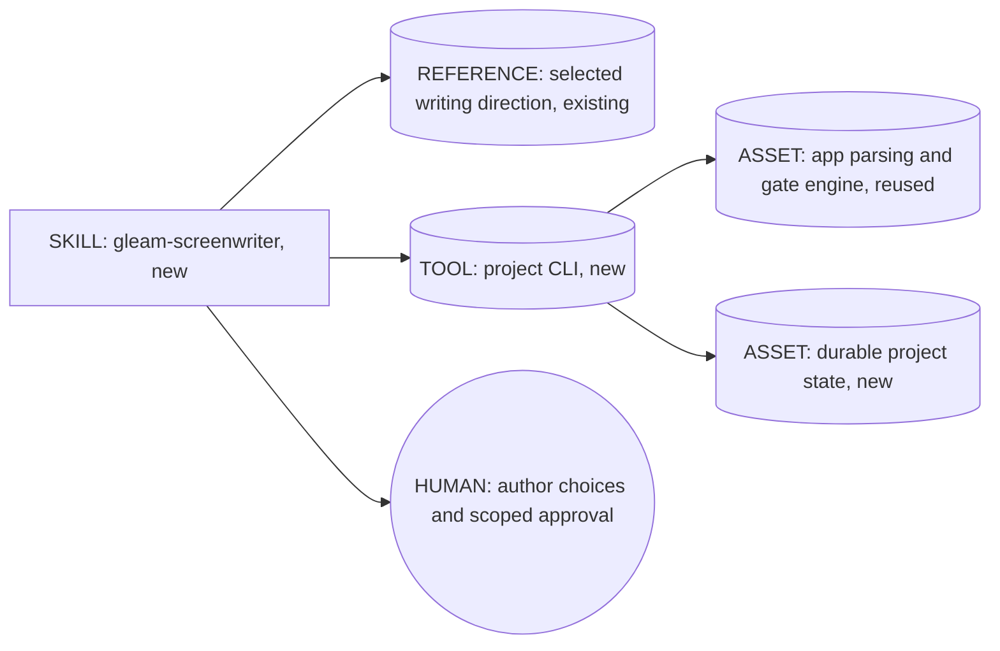
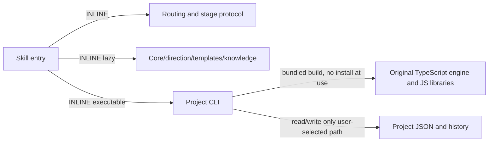

# Gleam Screenwriter Skill design / 2026-10-26

Scope: package the existing local screenplay workflow as one portable, project-oriented Agent Skill. The model supplies creative judgment; a bundled deterministic CLI owns persistence, artifact parsing, gates, batches, document text extraction and ZIP output. The desktop UI, browser state, SQLite account model and direct LLM API calls remain outside this distribution.

Targets: common-only substrate (read files, run a local CLI, write outputs). Standard SKILL.md discovery, with optional Codex UI metadata; no required companion skills, model override or automatic subagents. Node.js >=18 is an explicit runtime dependency; npm and a running App are not required at use time. Host file/terminal capabilities are probed first.



```mermaid
sequenceDiagram
  participant U as User
  participant A as Current agent
  participant C as Bundled CLI
  participant P as Project files
  U->>A: idea/source/project and requested scope
  A->>C: inspect/init + selected prompt/context
  C->>P: read state and current accepted material
  C-->>A: bounded context and missing deliverables
  A->>C: save current draft, run structural checks
  C->>P: atomic state, revision snapshot, receipt
  C-->>A: actual gate results
  A->>U: current-stage result and relevant choices
  U->>A: approve/revise or previously authorized automatic scope
  A->>C: record approval or roll back approvals
  Note over A,P: single writer; no network or model calls inside CLI
```



Composition: one coherent user capability, seven stages are modes, not seven separately discovered skills. C1 lazy references, B4 persisted project/checkpoints, B8 status before each writing unit, B10 scoped creator confirmation, S7 deterministic file/gate/export boundary; A2 PIPELINE with no stage collapse/infinite planning/tasks without plan. No competing architectural pattern is needed. Generic screenwriting and script prompting skills remain untouched; this skill is selected for the named seven-stage workflow or recoverable screenplay projects.

Interface: `init`, `list`, `status`, `source`, `set`, `message`, `prompt`, `ingest`, `check`, `approve`, `rollback`, `batches`, `stats`, `import`, `export`; JSON stdout/errors with exit status, explicit project paths. Approval requires a recorded real confirmation; structural gate success never implies artistic approval. Upstream edits preserve later drafts but revoke affected approvals. Files are atomic; snapshots are append-only. Import source content is data, never an executable instruction.

Distribution: runtime references and built CLI only. Maintainer design/evals/build helpers/raw TS snapshots stay outside the user-facing skill directory. Missing upstream app license remains identified as unconfirmed; no new license is asserted over inherited prose. Bundled library licenses ship with vendor code. No personal projects, keys, app runtimes or node_modules.

Cost stance balanced, no explicit cap. Same host model; no model-tier overrides or paid model calls. S: read/status 0 generated writing, ~1-3k context tokens. M: one planning/stage unit ~3-10k input and 0.8-4k output tokens. L: one episode/batch ~5-18k input and 1-6k output tokens per unit; whole-series totals scale with requested count. These are planning estimates, not measured/billed usage. No dollar estimate can be substantiated without the user's host/model/rates; do not invent it. Stable core then direction then mutable project context; never load all legacy templates or all episodes by default.

Evaluation plan: deterministic tests for blank project, original/adaptation routing, no BL/English defaults in general mode, failed/successful gates, explicit confirmation, rollback invalidation, revision conflicts, state recovery, portable ZIP, document extraction, and independent extraction/run from ZIP. Forward-test one representative real request in an isolated temporary workspace through an evaluator allowed by skill-creator's independent forward-testing instruction; no network/model service calls or live project mutation. Comparison cases and trigger queries are recorded separately, and unexecuted comparisons are not reported as passed.

External artifacts: one `gleam-screenwriter/` Skill directory within ZIP plus an external quick-start/validation note. Runtime receives only bundle resources, real user inputs and its project state. Maintainer plan/evals never become runtime prompts.

Todos: (1) vendor exact reachable app engine and runtime writing resources; (2) CLI and script contracts; (3) short SKILL and progressive references; (4) tests + independent behavioral check; (5) package + provenance + project indexes/install mapping. No Git commit/push or shared-library installation requested, so no installation sync.
