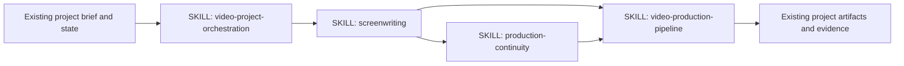
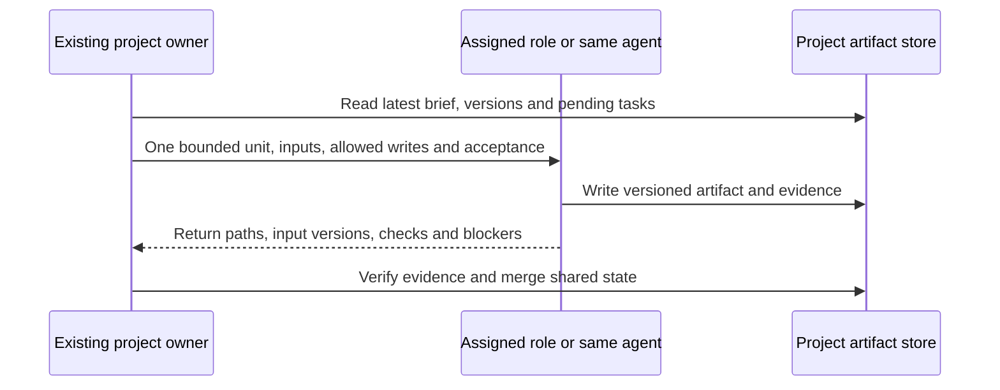

# Video Production 合并设计

2026-10-30：按用户明确授权，将原四个独立 Skill 合为一个 `video-production`，作者 oTATo-Boss，Codex 辅助实现。当前入口为 [SKILL.md](../skills/video/production/video-production/SKILL.md)。

- 模块：编剧、项目统筹、连续性、制作交付；均为包内方法文档，不独立安装。
- 按需加载：局部写作、检查或修改进入相应模块；完整项目按统筹、编剧、连续性、制作交付推进。
- 共享同一套剧本／资产版本、制作单元、输入输出、检查证据和恢复状态。
- 变更闭环：记录新版本 → 连续性影响分析 → 统筹局部返工 → 制作与组接复核。
- 旧四个项目入口及安装映射移除；本机副本按项目规定在推送后同步，本次未执行。

以下为 2026-10-16 初始设计的历史原文；其中旧 Skill 名称只供溯源，当前布局以上述入口为准。

---

# Video production skills v1 design

2026-10-16. Consumer: AI-SMA v2 and standalone video projects. Each package is an independent, harness-neutral method skill. The user's project owns its folders, task tool, credentials, approval boundaries and delivery contracts.

Edges represent optional workflow composition, not mandatory package imports. Each skill has its own runnable-by-agent procedure and inline artifact examples; no sibling file is needed at load time. Renderer and generation tools belong to the selected project, not these skills.

Single writer owns each shared manifest. Independent work may use the client's native child agents; absent that capability the same role packets run sequentially and review is labeled self. No new agent framework or client settings are installed by these methods.

| Module | Input | Output | Excludes |
| --- | --- | --- | --- |
| video-project-orchestration | Goal, constraints, project state | Work packages, handoffs, checkpoint | Creative direction, renderer implementation, installation |
| screenwriting | Brief, research, approved story and scope | Treatment, script or revision and production notes | Unasked full prose, shooting or publishing |
| production-continuity | Approved script, assets, cuts, change request | State ledger, discrepancies, impact set | Invented canon or automatic creative rewriting |
| video-production-pipeline | Approved units, assets and delivery specs | Versioned production manifest, QA and delivery evidence | Selecting the user's story or claiming unobserved playback |

Composition: short common procedure in each entrypoint; long-form, example artifacts and route-specific guidance loaded only for the active mode. Cost stance balanced: existing model settings, no per-model routing; one bounded work unit at a time, concise receipts, persisted project state for resumption. No dedicated runtime dependencies for the four method skills. The image bridge separately requires Python and an actual compatible, authenticated Codex CLI.

Validation: lint four entrypoints and links; exercise film/series, explanatory, narrative MV and partial-edit scenarios. Parent AI-SMA validation must record actual use on four rendered samples. Unit tests for the image bridge cover output ownership, unavailable capability, recovery paths, Unicode paths and non-overwrite. Structural checks do not prove creative effectiveness; controlled with/without-skill model evaluation and native Windows/Linux execution remain separately reported until run.
