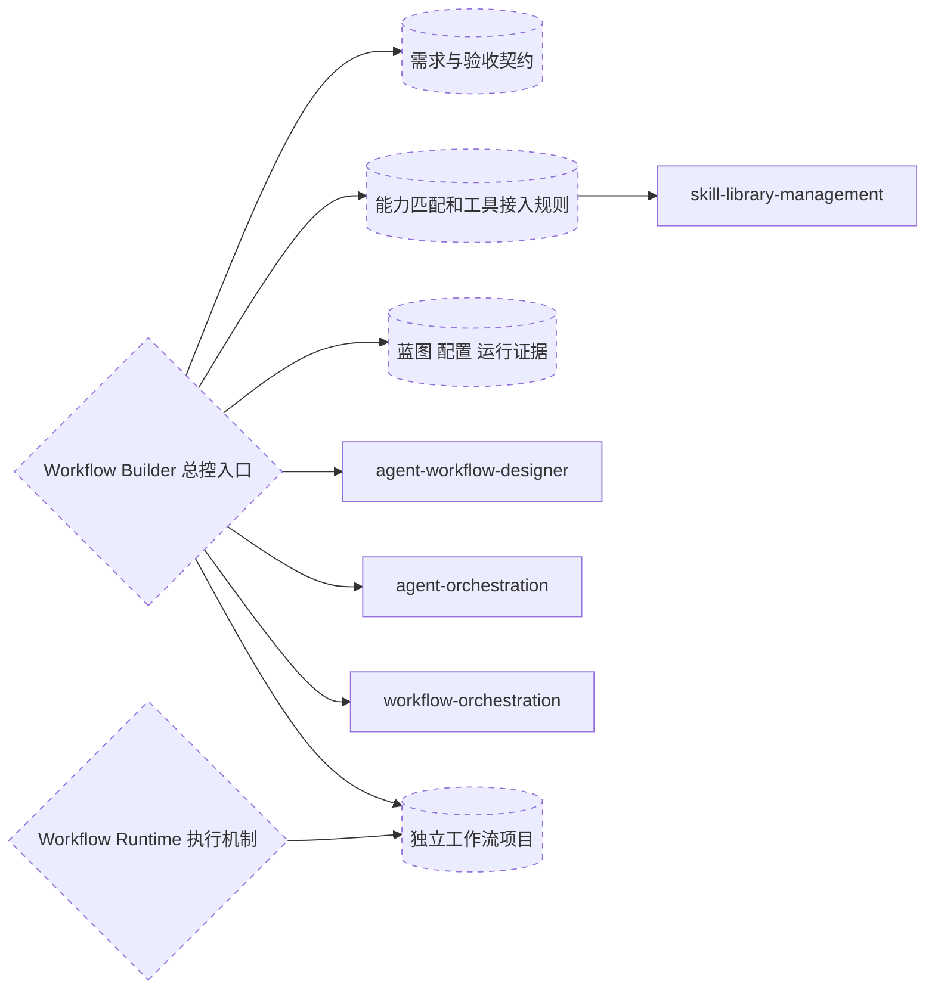
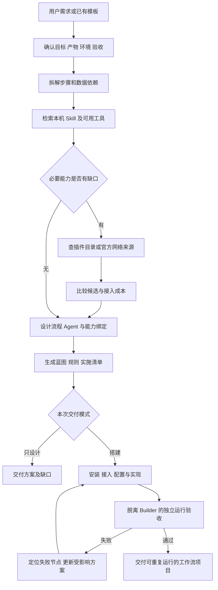
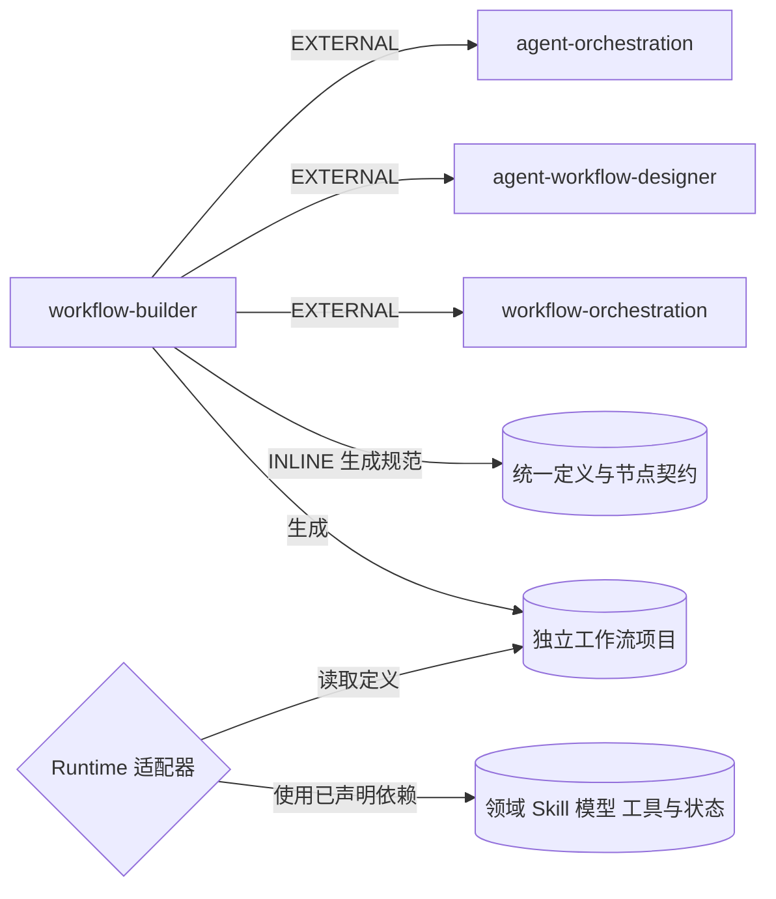
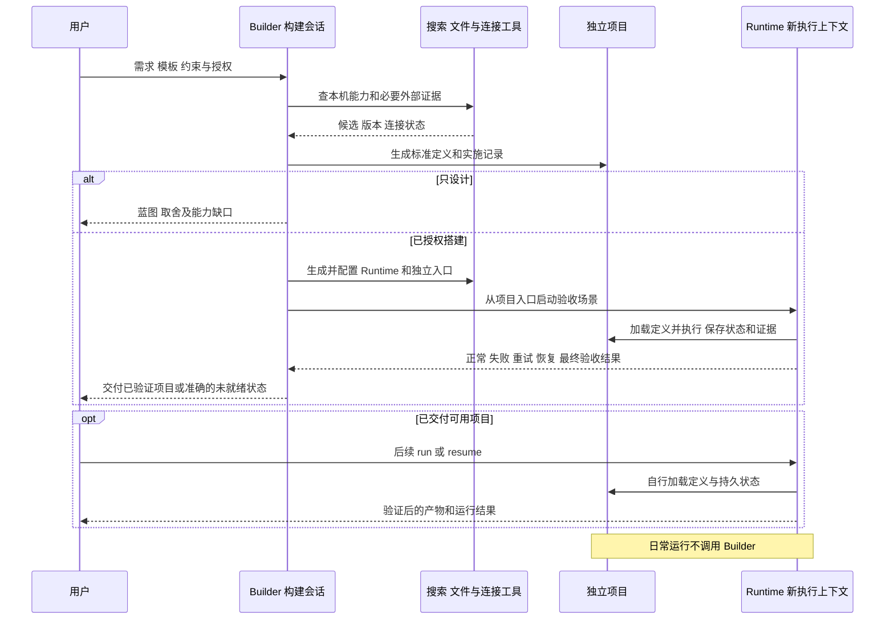

# Workflow Builder 设计方案

日期：2026-10-28。修订：v0.2，补强 Builder／Runtime 分离和独立运行验收。状态：方案已确认，0.1.0 源码已实现；安装与外部连接未执行。实施范围和证据见 [验证记录](validation.md)。名称：`workflow-builder`。

## 1. 目标与完成条件

把用户描述的目标转成适合其实际环境的工作流：澄清产物和约束，拆解任务，选择模板与执行方式，配置 Agent、Skill 和工具，生成规则、配置与操作入口，再用最小样例验证。

用户可以选择只设计、设计后搭建，或改造已有工作流。只设计时输出蓝图及缺口；搭建时继续完成已授权的安装、连接、配置和验证。日常执行某个已建工作流由它自己的入口负责，不反复进入搭建流程。

这是新增的总控入口。其价值集中在现有三个技能之间缺少的需求归一化、本机能力匹配、连接接入和交付验收；不重写三个技能的已有知识。

Builder 和 Runtime 必须分离：Builder 负责分析、设计、生成、配置、测试与交付；Runtime 负责启动、执行、调度、节点与最终产物验证、重试及恢复。Runtime 是执行机制，可以由原生 Agent 客户端、脚本或混合实现承担，不新增一个负责规划的 Runtime Skill。

交付后的项目通过自己的入口加载工作流定义与运行依赖，不调用 workflow-builder，也不依赖 Builder 会话的聊天历史、临时文件或记忆。独立运行允许使用明示的模型、凭据、已安装领域 Skill 和目标客户端；不是声称无任何外部依赖。

默认先评估当前 Agent 客户端能否实际承载所需执行、状态和恢复能力；不能满足就生成脚本或混合执行入口。用户需要无人值守、定时或独立服务时，交付对应调度和执行机制。具体平台选择依据现有项目、工具支持与用户偏好，不预设统一框架。

完成条件按模式判断：设计模式只交付“设计完成”；搭建模式必须从独立入口启动，真实完成约定样例，覆盖失败、重试、中断恢复、最终验收，并能再次运行，才可标记 ready。连接或验证受阻时交付有效部分、错误证据及恢复步骤，不宣布工作流可用。

## 2. 模块组成



| 模块 | 责任 | 组合方式 |
| --- | --- | --- |
| workflow-builder | 用户入口、阶段状态、需求到交付的协调 | 新增总控 Skill |
| 需求、能力和验收契约 | 保证阶段间交接字段一致 | 内置 references 与模板 |
| agent-workflow-designer | 选择编排模式，提供实现骨架，调用现有 DAG 和流程图工具 | 外部伙伴 Skill，按需加载 |
| agent-orchestration | 判断拆分是否必要，设计 Agent 职责、交接、并串行与预算 | 外部伙伴 Skill，按需加载 |
| workflow-orchestration | 跟踪搭建任务、验证、失败后的局部调整和交付记录 | 外部伙伴 Skill，按需加载 |
| skill-library-management | 安装新技能时维护来源、分类、索引和客户端入口 | 仅发生库变更时调用 |
| 独立工作流项目 | 持有标准定义、运行入口、业务规则、依赖绑定与验证标准 | Builder 的交付物 |
| Workflow Runtime | 加载项目并执行、调度、验证、重试和恢复 | 项目内代码或已验证的原生执行机制，不是规划 Skill |

三个伙伴 Skill 是设计与搭建过程的依赖，不自动成为生成工作流的运行依赖。生成的工作流只携带自己实际需要的领域技能和工具。

每个阶段只加载当前需要的说明和参考。框架代码生成、接入说明与领域知识分别按需读取，避免把所有技能内容拼成一个庞大提示词。

## 3. 总体流程



这里的检索与设计允许小范围迭代：发现实际工具限制后调整 Agent 或步骤；不为维持最初的图而引入不必要的服务。

交付后的运行路径是“用户或调度器 → 项目 Runtime → 执行与验证 → 产物”，不经过 Builder。只有用户提出工作流变更，或运行暴露出必须修改定义的缺陷时，才显式回到构建模式；运行时的业务分支或 Agent 内部推理不触发架构重设计。

## 4. 各阶段输入、工作与交付

| 阶段 | 关键工作 | 输出及通过条件 |
| --- | --- | --- |
| 需求分析 | 明确用户、输入、最终产物、频率、质量标准、运行环境、预算及已有资源 | requirements：目标、限制、假设、验收条件；仅追问会改变设计的缺失信息 |
| 步骤拆解 | 列出每步输入输出、先后关系、执行单元、完成条件和失败策略 | task graph：每步有完整契约，可追踪到验收条件 |
| 能力盘点 | 读项目及本机分级索引，检查可见工具、已有客户端与连接 | capability map：每项必要能力都有已验证提供方或明确缺口 |
| 流程与 Agent 设计 | 选择模板，合并可共享上下文的步骤，隔离需要独立职责的任务 | workflow blueprint：节点、职责、交接、工具绑定、状态与异常路径 |
| 规则生成 | 确定触发、路由、技能选择、质量门槛、并发、重试、超时、恢复与结束条件 | workflow rules：明确适用工作流、执行方式和约束来源 |
| 环境搭建 | 按授权装技能、接服务、配置运行环境，生成并绑定 Runtime 与独立入口 | implementation：项目能自行加载定义、规则、依赖与状态，不借用 Builder 会话 |
| 验收交付 | 新执行上下文中覆盖正常执行、失败、重试、中断恢复、最终验收与重复运行 | validation report：全部必需项通过才标记 ready；失败保留证据和真实状态 |

## 5. Agent、Skill 与工具怎样分配

先明确任务，再决定执行单元。流程节点不必一一对应 Agent；脚本适合完成的固定变换直接用脚本。

- Agent：承担职责与推理，具有自己的输入、输出、上下文及工具范围。
- Skill：为该职责提供方法、规范、模板或脚本。
- 工具：通过 CLI、插件、MCP 或 API 完成真实读取与操作。
- 工作流：规定这些执行单元的顺序、数据交接、条件分支与完成判定。

Agent 拆分条件是独立并行价值、相互冲突的专业指令、上下文隔离或可单独验收的职责。单个 Agent 能可靠完成时保留单个；即使最终工作流有多个业务 Agent，搭建它的总控也不必启动同样数量的子代理。

每个业务 Agent 的规格包括：角色 ID、目标、输入、输出结构、完成条件、使用技能、允许工具及动作、模型能力要求、时间或 Token 预算、失败处理和状态读写范围。

每条交接包括：上游产物引用、输入结构、必需字段、接收方、校验方式和失败回退位置。不要把整段聊天记录当作交接数据。

模型只在用户选择或运行环境允许的范围内绑定；规划阶段用能力等级描述职责，不擅自替用户切换当前模型。若平台不能强制限制工具或预算，标注为执行约定，不能描述成系统已强制隔离。

## 6. Skill 选型与外部搜索

### 本机优先

按“项目索引 → 本机总入口 → 相关分类 → 候选 SKILL.md”定位。结合当前会话的系统和插件技能，避免扫描或加载整个库。

候选不仅看名称，还核对：是否覆盖所需输入输出、是否含必要脚本、适用平台、依赖、使用限制及实际可用性。本机已存在且适合的技能直接绑定；插件提供执行能力、Skill 提供方法时可同时使用。

### 缺口驱动的网络搜索

先写清缺失能力，再查相应官方插件目录、官方文档与源仓库。已有服务插件可完成任务时优先复用；需要新 Skill 或 MCP 时查原始维护方及安装资料。

通常比较最多三个有效候选，只有覆盖不足时扩大。评价适配度、维护证据、依赖成本、平台兼容、许可和是否需要额外付费；“最佳”指当前需求与约束下最合适，不承诺全网绝对最优。找到充分合适的选项即可停止。

保留候选来源、检查日期、选中原因与版本或提交。安装前检查同名冲突和本地修改，安装行为遵循技能库规则与用户授权；不能因需要某个能力就默认开通收费服务。

能力状态至少区分：候选、已找到本机入口、已安装、已做适用性检查、已在本工作流中验证。读取说明不等于该能力已通过实际运行。

## 7. MCP、插件与其他工具接入

按必要动作确定工具，而不是先给每个 Agent 安装 MCP。优先复用当前可用的插件、CLI 或现有 MCP，已有能力足够时不增加新连接。

接入过程：发现可用工具 → 核对所需动作与参数 → 检查安装和配置 → 核对账户、目标资源与授权范围 → 执行必要的认证 → 用最小读取或可逆操作探测 → 绑定到对应节点。

状态分别记录：已发现、已安装、已配置、已认证、所需动作已验证、受阻。读取动作成功只证明该读取范围可用，不证明写入、发布或其他资源也有权限。

无法由当前工具完成 OAuth、账户选择或客户端重载时，给出具体缺失步骤；保留工作流进度，待用户完成后继续探测。只对确实缺少的信息或授权提问，已有授权不重复索取。

配置文件只写环境变量名或凭据存储引用，不把密钥、令牌或个人账户配置写入工作流交付包。现有项目和全局配置采用最小增量修改，不覆盖无关项。

工具登记包含：提供方、调用方式、所需操作、账户或资源选择依据、连接状态、探测证据、允许动作、重试条件和恢复步骤。

## 8. 统一工作流规范与节点契约

以平台无关的 `workflow.yaml` 作为已发布工作流定义的唯一维护源，配套版本化数据模型和校验规范。解析后的数据可用统一 Schema 校验；JSON 只作为工具交换或派生输出，不再维护另一份可独立修改的 workflow.json。既有 DAG 工具需要时从定义生成其支持的 steps 投影。

工作流定义至少包含：schema_version、workflow_id、revision、goal、inputs、outputs、runtime、trigger、steps、resources、rules、acceptance。动态运行状态不写回这份定义。资源用稳定 ID 引用；定义版本与输入摘要写入每次运行记录。

| 节点契约字段 | 必须说明的内容 |
| --- | --- |
| id / depends_on / when | 稳定身份、数据依赖和可判定的分支条件 |
| inputs | 数据来源、格式、必需字段与输入校验方式 |
| executor | script、agent 或 hybrid；具体入口、角色或适配器 ID，以及工具资源绑定 |
| outputs | 命名产物、格式、保存位置或外部资源引用；供下游读取的字段 |
| completion | 真实验证器、断言或可审计人工验收；规定何时可以标记 passed |
| failure | 错误类别、可重试条件、尝试次数与超时、最终失败策略 |
| recovery | 检查点、重入方式、幂等或副作用核对方式 |

inputs、executor、outputs、completion、failure 为每步的最低契约，不允许用名称和自然语言简介代替。Validator 应检查引用、格式、执行绑定及完成条件是否可解析。运行时还要校验实际输入与输出，执行单元自报“完成”不能代替产物验收。

例如“生成报告”节点需要绑定一个真实入口，接收研究材料，产出报告文件，验证格式与必需内容，区分工具不可用和输出不合格，并明确是否允许重试。只填写“writer Agent 负责写报告”不满足契约。

规则覆盖适用场景、输入、数据交接、Skill 加载、工具、并发、质量门槛、错误处理和结束条件。总控及伙伴技能建议服从用户要求、项目规则和环境权限；已有授权的步骤连续推进，不机械重复确认。

步骤的数据依赖保持无环；审核退回和重试用有界重入或显式状态机表达，给出次数、预算和退出条件。现有 DAG 校验脚本只负责无环依赖部分，不代替状态机验证。

## 9. 标准项目结构与独立执行入口

```text
workflows/
  <workflow-id>/
    workflow.yaml            唯一工作流定义与运行绑定
    AGENTS.md                原生 Agent 使用时的项目规则入口，按需
    workflow-rules.md        工作流业务规则，入口明确加载
    README.md                依赖、配置、启动、重试、恢复和验收命令
    resources.lock.json      领域 Skill、工具、模板及适配器的版本和来源
    runtime/                 项目执行器或原生运行适配层
    scripts/                 实际执行、验证与接入脚本，按需
    agents/                  确有独立职责时的角色定义，按需
    tests/                   契约、失败、恢复和端到端验证场景
    runs/<run-id>/            状态、事件、尝试、检查点与验证证据
    outputs/<run-id>/         本次运行的最终产物或产物索引
    validation.md            已测能力、范围、结果和真实限制
```

必备的是可校验定义、独立入口、明确验收标准、运行记录和依赖说明；agents/ 等资源目录按需要创建。runs/ 和 outputs/ 可首次启动时生成；大型或外部产物可保存为可追溯资源引用。具体规则文件合并或拆开均可，但实际入口必须加载它们。遵守目标仓库规则，只在真正项目根维护项目索引或规则入口，不把临时任务目录变成新项目。

Runtime 对外统一提供 check、run、status、retry、resume、validate 的语义，适配器映射成当前平台真实可用的命令或原生入口，不凭空假定各客户端存在同名 CLI：

- check：检查定义、执行器、资源、认证与当前运行所需动作。
- run：以新 run_id 接收输入，启动执行并持久化结果。
- status：读取持久状态、错误、产物和验证记录，不进入重设计。
- retry：根据契约为允许重试的失败节点创建新 attempt。
- resume：在新执行上下文中读取检查点，继续可恢复任务。
- validate：验证节点产物和最终业务验收条件，给出可检查结果。

项目 README 交付这些操作的具体使用方式。脚本 Runtime 应有真实入口、退出状态和结构化结果；原生 Agent Runtime 应有用户能在新会话调用的明确入口、加载流程、进度存储和验证动作。仅提供“请按这个 YAML 执行”不构成已验证的 Runtime。

若原生环境不能可靠完成状态持久化、超时、重试或恢复，应由项目内脚本补足或选择混合实现。已有执行器满足要求时优先复用并声明依赖，避免每个项目重写执行或调度系统。所有声明支持的能力必须经过验证；不支持的必要能力会阻止 ready。

无人值守或自动触发任务另外声明实际调度器、触发参数、输入来源、所用身份、并发或重复触发策略、失败反馈与停用方式。交付时验证触发到执行的链路；手动运行通过不能代替调度验证。交互式项目不无故添加后台调度。

## 10. Runtime 的执行、状态与恢复

Runtime 按定义加载输入与依赖 → 选择 ready 节点 → 调用执行单元 → 验证输出 → 提交检查点 → 推进依赖 → 做最终验收。工作流 ready 表示交付包通过验收；单次运行 succeeded 表示该次产物通过验收，两者分开记录。

运行实例状态至少区分 pending、running、blocked、failed、interrupted、cancelled、succeeded；支持取消时应有明确的停止与检查点策略。

节点状态包括 pending、ready、running、passed、failed、blocked、skipped、interrupted；attempt 另行记录 retry_wait 等过程状态。只有依赖通过且分支条件满足才进入 ready；输出验证通过才 passed，分支跳过必须有依据。最终工作流完成也要运行整体验收，不能只看所有进程已退出。

每次运行至少记录 run_id、workflow_revision、inputs 摘要、runtime 与资源版本、起止时间、节点和尝试状态、输出引用、错误类别、验证结果及检查点。Builder 的构建状态与这些业务运行状态独立保存。

小型本机项目可用原子写入的状态文件和追加事件日志；并行或服务场景按需要使用事务存储。一个 run 的状态有单一写入者或显式协调机制，防止恢复和重复触发同时推进同一任务。进程失联后核对运行归属、锁或存活状态，再把遗留 running 标为 interrupted，不能把仍在执行的任务重跑一遍。

重试仅用于契约允许的错误，保留每次失败原因、日志、attempt_id、已用次数和预算；配置错误、认证缺失等转 blocked，不进行相同输入的无效循环。产物不合格可按业务规则有限返工，不自动修改工作流定义。

恢复从持久状态与已提交产物开始；核对定义版本、输入和依赖是否与检查点一致。上游产物改变时失效对应下游结果，不复用旧 passed 状态。更换定义后的恢复需明确迁移或新 run，不静默解释旧检查点。

对写入、发送等动作记录意图与结果凭据，优先使用工具支持的幂等键。动作已发生但结果未能写入检查点时，将其标为结果未知，先核对真实系统；不能宣称通用 exactly-once，也不能直接自动重做不可核对的动作。

Runtime 不调用 Builder 或三个构建伙伴技能来重新设计架构。遇到定义缺陷或不支持能力时保留失败证据，说明需要显式修订；新的 Builder 会话可读取该报告生成下一版项目。

## 11. 平台适配与依赖隔离



定义与契约保持平台无关；适配器负责定义加载、Agent 启动、脚本调用、Skill 加载、工具绑定、验证、状态与恢复以及可选调度。原生、脚本和混合三种模式均须实现上述共同语义，不能靠产品名称推定能力。

为每个适配器维护能力矩阵：原生 Agent、脚本、工具访问、持久状态、超时与取消、重试、恢复、后台执行、定时触发。每项区分可用、缺配置、缺授权、不支持、未验证，并给证据。平台选择据此匹配用户需求，不硬编码“支持 Skills 就具备相同运行能力”。

首版可优先交付当前环境可验证的一种 Runtime，再扩展 Claude Code、Cursor 等适配器。目标客户端的工具可见性、OAuth 或会话绑定也属于运行依赖：如果连接只存在于 Builder 会话，新会话或后台运行必须重新验证可用性，否则不能声明可独立运行。

生成项目只依赖 Runtime、业务规则和实际需要的领域资源；Builder 与三个规划伙伴不进入业务执行闭包。发布验收在不加载这些构建技能的上下文中完成，确认启动路径不回流 Builder。

伙伴依赖按名称从真实索引解析，在使用处检查入口和资源。生成项目以 lock 文件记录运行依赖、版本与来源，并提供安装或配置说明；不依赖 Builder 临时目录中的文件或未声明的绝对路径。

本次已确认伙伴版本：agent-orchestration 提交 97a13607d669157a4a16d5ba79b77f208319f7b9；workflow-orchestration v1.0.0、提交 547a0a0de6395eebed16f2e86043faf3cfb0863e；agent-workflow-designer v1.2.0、提交 2c12c7efaad13a70bdea6e205698a6c4f93a0682。第三者许可标识为 MIT + Commons Clause，保留原始许可和来源。采用引用组合，第三方目录继续独立管理。

缺少构建依赖时可交付明确降级的设计，不虚报脚本检查；缺少必需运行依赖时项目不得通过 ready 门槛。

## 12. 构建与运行交接、成本控制



默认一个搭建会话顺序推进。只有独立复杂候选研究或专业审查确实有价值、且当前环境允许委派时才增加子代理；本次设计没有计划实际启动子代理。增加时给出独立任务、最小输入、输出结构、完成条件与预算，回传证据由总控合并。

成本立场默认 balanced；优先复用本机资源、按阶段加载资料、确定性脚本承担校验和绘图。稳定规则与动态状态分离，避免每步重读整个库或整段历史。

规划类工作使用能满足推理质量的能力等级；候选信息提取、文件校验与资源状态检查优先使用工具或较轻执行单元。只有实际需要的工具定义进入当前阶段。

容量预估用于首版设计，不是实测、承诺或新增硬上限：

| 场景 | 形态 | 规划容量范围（累计输入／输出 Token） |
| --- | --- | --- |
| S：现有模板，能力齐全，只需设计 | 单会话、少量索引和模板读取 | 约 8k–20k／2k–5k |
| M：多个职责，一项能力缺口，需要本机实现 | 单会话、定向搜索与脚本验证 | 约 20k–60k／5k–15k |
| L：已有复杂工作流改造、多个连接或运行环境 | 分阶段处理，确有必要再委派 | 约 60k–180k／10k–30k |

实际开销取决于模型、缓存、工具输出和迭代；目前没有选定计费模型，美元价格未知，不用上游价格快照冒充当前报价。进入搭建时再按实际模型报价或账户计费方式估算，并记录工具调用和迭代情况。有用户预算上限时，在执行前和超出预期时检查。

## 13. 独立运行验收与构建器评估

交付包状态依次区分 designed、generated、configured、verified、ready；出现缺口保留 blocked 或 failed 的具体原因，不跳过未通过的阶段。verified 必须有执行证据，ready 必须覆盖下列门槛。

验收报告绑定定义版本、Runtime 与资源锁摘要、输入样例及产物验证器版本。修改定义、执行代码或关键依赖后，原 ready 证据不能自动覆盖新版本；重新运行受影响场景，记录新的验收结果。

| 场景 | 验证动作 | 必须留下的证据 |
| --- | --- | --- |
| 契约和环境 | 校验定义、引用、依赖、执行绑定、规则加载、所需工具与授权 | 结构报告、资源版本与探测结果 |
| 独立启动与正常执行 | 在新的进程或原生会话中，只用交付入口、定义与声明依赖跑完真实样例 | run_id、节点轨迹、产物及验证结果；无 Builder 调用依赖 |
| 执行失败 | 对受控节点注入工具失败、无效输入或不合格产物 | 准确失败节点与错误；下游未错误通过，非成功结果可查 |
| 任务重试 | 注入一次可恢复错误，再通过项目 retry 或自动策略继续；另覆盖重试耗尽 | attempt 计数、上限、生效策略、最终结果及未重复写入证据 |
| 中断恢复 | 在检查点处中断执行，结束原执行上下文，再用 resume 恢复 | 检查点、新执行记录、已通过节点正确复用、未完成任务继续 |
| 最终验收 | 即使执行器返回成功，也检查内容、格式、必需字段及用户业务标准 | 独立验收结果；不合格产物不能令 run 成功 |
| 可重复运行 | 再次从入口发起新 run，不借助前次聊天历史 | 新 run_id、隔离产物和一致的验证行为 |
| 自动触发（需要时） | 实际触发一次调度或事件路径，并检查停用和重复触发策略 | 调度器记录到 Runtime run_id 的关联及结果 |

失败、重试和中断恢复是所有可运行交付的验收维度；纯脚本等不需要重试的节点可声明不重试，但必须验证失败会正确终止并给出重启或恢复边界，不能默默略过这一维度。原生运行方式无法跨会话恢复时，须补足机制或标为不支持，不能用同一聊天内的“继续”充当恢复证明。

故障注入应在隔离场景或测试适配器完成，行使真实 Runtime 的错误与恢复路径；真实外部服务连接另行提供授权范围内的证据。模拟工具通过不能冒充真实服务已连通。涉及不可逆动作时使用已授权样例或明确的测试替代，并记录未验证的范围。

独立启动验收按已声明的运行环境进行，不强制把所有业务技能打包复制；但运行资源必须可解析，模型与凭据配置有说明，Builder 的隐藏上下文和临时目录不可作为依赖。所有必需场景未通过时，交付物只能称为方案、已生成项目或未就绪项目。

构建器本身另外采用三种内容场景，分别比较加载技能与不加载技能的结果，所有变更在隔离测试目录内，外部操作仅使用模拟或已有授权：

- 本机能力齐全：搭建资料到报告的交互流程。应复用本机技能、保持最小 Agent 数，生成标准项目并经 Runtime 独立跑通。
- MCP 认证缺失：搭建读取外部数据再生成材料的流程。应区分发现和连接成功，交付可用部分并明确恢复步骤。
- 不合适的模板：模板包含多余 Agent、共享写入和错误依赖。应依据需求调整结构，而不是照搬模板。

触发评估准备 20 条请求，12 条开发集、8 条保留验证集，各自包含正例和近似反例。正例覆盖从零搭建、按模板改造、能力缺口、连接接入及运行环境迁移；反例覆盖日常执行现成流程、普通单文件修改、单独询问技能作用或仅安装指定技能。关键反例误触发要修正描述，避免接管无关工作。

## 14. 后续开发范围与顺序

建议开发目录：`skills/dev/workflow-builder/`。只在开始开发后创建 Skill 源码；第三方原包不复制进本项目。

构建 Skill 分发结构为 SKILL.md、少量按需 references、标准定义 Schema、项目模板和有实际价值的校验／生成脚本。Runtime 模板按目标生成到交付项目，构建器评估资源放在开发测试范围；不新增规划 Skill。SKILL.md 保留入口、阶段路由、约束与加载条件；遵循 [Agent Skills 规范](https://agentskills.io/specification)的渐进加载结构。

实施清单：

- [x] 审定本方案，首版采用 POSIX JSON 子进程 Runtime，平台能力缺口明确披露。
- [x] 定义 workflow.yaml 的版本化 Schema、节点契约、运行记录与产物验收契约。
- [x] 编写总控入口、能力匹配与工具接入规则、目标环境适配规则。
- [x] 提供标准项目模板和可用 Runtime，落实 check／run／status／retry／resume／validate 入口语义。
- [x] 实现持久状态、错误与尝试记录、检查点及副作用恢复策略；首版直接复用已有 jsonschema 库校验，不复制伙伴脚本。
- [x] 对首个目标 Runtime 完成独立启动、正常／失败、重试耗尽、中断恢复、最终验收与重复运行验证。
- [x] 完成三个构建内容场景及触发评估；调度不在首版已实现范围。
- [x] 保存来源与版本记录，同步项目索引和 INSTALL_MAP.json。
- [ ] 用户已授权提交、推送及安装；发布时先推送，再依项目规则检查并同步安装副本，结果另记安装回执。

设计讨论阶段未执行开发；本次经用户“做吧”授权后已完成上述源码与本地验证。提交、推送、安装和真实外部服务连接仍未执行。

## 15. 人类可读的设计理由与未决项

用户真正需要的是从需求到可重复运行系统的闭环。三个现有技能提供结构设计、协作约束和实施纪律；Builder 衔接资源发现、生成、配置与交付，Runtime 承担执行、状态与验证。新增规划能力无法替代执行机制，两者通过标准定义、实际入口与验收证据交接。

搭建过程有明确阶段依赖，默认单会话流水线更容易保持需求、资源选择和配置一致。业务流程是否多 Agent，应由业务本身决定；不能因为搭建器用了三个 Skill，就让每次搭建启动三个 Agent。

尚未确定的运行平台、模型、外部账户和业务输入，是每次搭建的需求参数。首版需选定并真实验证一种原生、脚本或混合 Runtime，不能只交付统一规范就宣布支持所有客户端。无人值守和独立服务按用户真实需要适配。

本次已开发首版 Runtime 并完成本地样例的独立运行验收。并行、分支、原生客户端和调度保持适配扩展目标；没有通过第 13 节验证的具体业务项目不得标记 ready。真实连接、模型调用与生产业务验收尚未执行。
