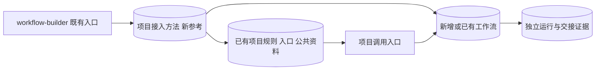

# Workflow Builder：已有项目接入扩展

日期：2026-10-28。目标版本：0.2.0。范围：补充构建方法、按需参考与验收要求；不修改随包 0.1.0 Runtime 或强制引入通用注册文件。

## 已确认的需求

Builder 能在已有项目新增或整合工作流。构建 Agent 根据实际业务决定公共资料、配置和产物布局，不固定使用账号运营类目录或文件。业务运行继续由项目入口和各工作流 Runtime 负责，不进入 Builder。

## 结构与交接

新增参考采用 INLINE 组合，主入口只增加任务模式选择与加载条件；现有生成器、Runtime 和三项伙伴 Skill 保持各自职责。

- PROJECT_ROOT：真正承载规则、公共资源与调用约定的项目根。
- WORKFLOW_DIR：某一工作流的定义、执行器与运行状态目录；独立项目时可与 PROJECT_ROOT 相同。
- 接入输入：目标项目、工作流目标、已有入口与约定、公共资源位置、上下游契约。
- 接入输出：最小增量变更、真实调用路径、明确共享依赖、产物交接和验证证据。

## 流程

1. 区分新建独立项目、已有项目新增、多个已有工作流整合；依据规则和现有结构确认项目根。
2. 有针对性地读取规则、公共资料、入口和待接入工作流；不把任务目录或 workflows 子目录当成新项目根。
3. 决定是否复用或补充公共资料、登记、路由、适配与交接；具体名称及格式由 Agent 按现有约定确定。
4. 在新的非冲突工作流目录生成，或针对既有流程做最小修改；不向已有根目录整体覆盖模板。
5. 明确公共上下文如何被真正读取；保持每个流程状态隔离，跨流程用明确产物引用交接。
6. 验证项目入口调用、工作流独立调用、旧流程回归、共享资料加载与必要交接，再交付。

## 边界与验收

登记可先复用既有说明或规则表；需要程序路由时再实现实际读取清单的入口。只写文件不能声称自动发现或调度已实现。公共规则不自动穿透独立脚本 Runtime 的路径边界，应由 Agent 选择显式传参、版本化快照或适配器读取，并验证生效。

不强制建立 AGENTS.md、account.yaml、workflows.yaml 或业务目录；沿用已有规则入口和组织方式，必要时增量补充。新增流程不无故移动、重构或重写旧流程，原有通过状态不能被新流程错误复用。

本轮验证重点是 Agent 的实际接入行为，使用隔离的非账号类已有项目。记录原有文件与旧流程的基线，新增一个流程、整合交接，在新进程从项目入口及各工作流入口调用。检查未误建业务模板目录、未覆盖既有规则，以及输入输出能正确交接。

## 实施与验证结果

已在主入口加入三种模式选择、PROJECT_ROOT／WORKFLOW_DIR 边界、参考加载条件和接入验收；新增 references/project-integration.md，更新 UI、来源和版本记录。生成器、全部项目模板资源、Runtime 和 Schema 已逐字核对与 0.1.0 已验版本一致，因此本轮没有重复运行其 20 项执行器回归。

依据 skill-creator 的前向验证方法，独立评估者只读取本 Skill，在隔离的非账号类“Lab Portal 实验笔记项目”完成真实接入；未读取源码仓库的评估和测试文件，未改仓库／安装目录，未安装依赖或连接外部服务。

| 检查 | 实际结果 |
| --- | --- |
| 已有规则和布局 | 沿用 agent.md、knowledge/、config/jobs.json、tools/project.py；不增加 account.yaml、workflows.yaml 或重复 AGENTS.md |
| 新增工作流 | 在既有 tasks/ 约定下新增 review，保留 summary；通过项目入口和各自 Runtime 均可启动 |
| 公共资料消费 | 审读产物实际使用 knowledge/project.json 的项目、语言和质量标识；保存原文快照及散列 |
| 跨流程交接 | 显式选择 summary 的 baseline run，核对已验报告与散列，保存上游 ID、版本、路径及来源信息 |
| 旧流程保护 | 独立评估记录原始 27 个文件仅增量修改规则、README 和清单；其余 24 个文件不变。主线程另核对旧定义、执行器、baseline 状态、baseline 产物和原始资料散列，以及规则原文前缀 |
| 可执行验证 | 8 项黑盒子进程检查通过：跨目录调用、独立执行、上下文消费、重复运行、重试及耗尽、检查点恢复、来源篡改拒绝、最终验收拒绝 |

项目保留在临时目录 workflow-builder-integration.rx_l6tl7/lab-portal；旧流程回归 run 为 rfb640378ba4e4427b58c，新增审读样例 run 为 r61d97c3d680447d3b729，review.md 和 trace.json 均真实生成，后续 validate 通过。临时目录可能被系统清理，精简证据另存 project-integration-evidence.json。

该业务样例状态为 verified：仅做本地结构、条目数、中文字符和来源检查，不评价科学结论。未测试此业务适配器的强杀与未知副作用恢复，没有实现自动串联、定时或外部连接，不将上述结果表述为任意项目自动 ready。

包内引用、UI 元数据、Skill quick_validate、项目结构审计和差异检查通过。源码及安装副本修改前均与上次 15 文件安装回执一致，未发现独立修改；发布后同步证据另记本机安装回执。

## 0.2.1 目录与导入规则修正 — 2026-10-28

用户实用反馈表明，0.2.0 的“按既有约定存放／不无故搬目录”可能被解释为只添加外部调用入口。本节取代上文关于工作流位置可自由选择的设计；历史 0.2.0 测试仅证明当时的接入能力，不证明符合本次新规则。

已有业务项目中新建、开发或导入的完整工作流统一存放在 PROJECT_ROOT/workflows/<workflow-id>/，与 skills/ 的整包组织逻辑一致。外部添加默认复制源码和必要资源，保留来源，不依赖原始目录；项目入口实际使用内部副本。账号配置及 data/、content/、reports/ 等业务布局仍按需求决定。独立工作流项目仍可自行作为项目根；本次不迁移任何实际业务项目。

本次为说明与验收规则修正，Runtime、生成器、Schema 和模板未改变。验证范围为 Skill 格式、规则一致性、包内引用及发布后安装副本一致性；未重新执行真实业务流程，也不将历史验证当作新导入验收。

## 0.3.0 Skill 随包交付 — 2026-10-28

本节取代早期设计中允许工作流运行依赖构建机器本机 Skill 的约定。选型先本机、必要时互联网；实际使用的领域 Skill 完整内置于 WORKFLOW_DIR/skills/<skill-name>/，节点使用包内相对绑定。必要的子技能与套件资源一并闭合，保留来源、版本、许可、文件清单和摘要；仅参与 Builder 构建的规划伙伴不自动随包。宿主软件、模型、MCP 和账户凭据仍有明确安装／配置边界。

主入口、能力参考、项目接入、契约、验收和生成项目 README 已同步。Runtime、Schema 和生成器代码未变：相对 Skill 文档绑定已受支持，完整目录复制、引用修正与全包清单校验由 Builder 构建交付实现，不声称生成器会自动收集技能。

新增黑盒测试 test_bundled_skill_runs_after_relocation_without_source_library：将完整合成 Skill（指令、许可、可执行脚本、二进制素材）复制入工作流，核对文件与权限，将工作流移至新的 recipient/workflows/ 位置并删除隔离测试源库；新进程 check、run、validate 成功，适配器消费包内文档并调用包内脚本读取素材；删除包内素材后，新运行失败。测试通过。该测试验证现有 Runtime 的包内绑定和迁移执行，不证明模型调用、MCP 或每个真实 Skill 已通过可分享验收；未改动实际业务工作流或用户技能库。
