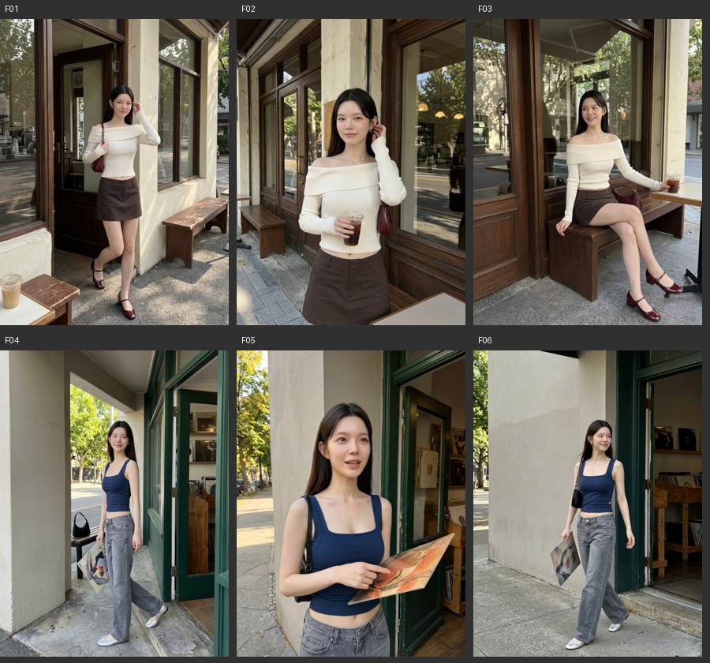

# 六张旧片与摄影参考的对照

这些是用户在本次对话指出偏离目标的六张实际 Flow 生成图。上排咖啡店，下排唱片店。缩小版本用于审片教学，源文件哈希见[清单](../assets/previous-outputs/manifest.json)。下列改法是创作建议，实际验证另记。

| 旧片 | 已成立的部分 | 决定偏差的摄影选择 | 应迁移的参考关系 |
|---|---|---|---|
| F01 门外全身 | 整套衣服与袜鞋清楚 | 人物窄，左下孤立杯子、右侧长椅和头顶门框占用注意力；好的日光落在墙与地面 | R14 全身的栏杆支点与腿展开，或改成 R26 隔桌近景；按分享重点选择 |
| F02 窗边半身 | 脸、肩线、针织纹可见 | 窗框、街道反射与人同样清楚；拿杯加拨发重复了普通动作，表情和受光未形成特别瞬间 | R12 袖口托腮把脸围住，或 R04 杯/纸袋和表情同框的关系 |
| F03 长椅坐姿 | 侧笑较活，腿与鞋有斜线 | 门窗直线比衣料细节更醒目；拍摄者仍从较远前方看人坐下 | R07 前倾撑手，或 R16 收腿、桌椅与近远层次，保留本图的笑 |
| F04 唱片店全身 | 方领、低腰裤与银鞋轮廓成立 | 大块墙与绿门衬一个较窄的人，头顶空间较多；包留远处凳上，脸旁无可读细节 | R21 脸与物件在同一尺度，或 R01 斜坐展开身体，选择与店内空间相合的关系 |
| F05 拿唱片半身 | 脸和橙封套形成潜在色彩对照 | 封套斜躺在腰前，脸和物件相隔较远；亮墙与绿门竖分画面；视线给了画外 | R26 的隔柜近距、R21 的物件脸旁位置；让唱片面向镜头，眼神有明确落点 |
| F06 走两步 | 行走身体关系可读 | 左上浅墙大块留白、右侧绿门强竖线；与F04提供的信息接近，离人物重点较远 | 重新选择店内柜对面或试听位，先决定照片边界，再安排一个静态姿态也可成立 |

## 旧提示词的影响

旧唱片店第三张同时使用三米距离、目光扫回朋友、淡妆、克制直出。JSON 旧他拍固定正文又偏平视或轻低机位、行走回头和自动测光，减小了不同摄影方法之间的差别。F01–F06 的主要问题可在小图直接看见，提升像素不能改变原有站位和透视。

## 用对照指导返修

先用匹配案例指出一项具体摄影收益，再选择改动。例如保留 F05 身份、藏蓝上衣、橙封套，把摄影者移到柜对面，封套竖到脸侧、下缘放进唱片格，检查新图在小尺寸是否能同时读到眼神和封套。若只增加“漂亮、高级”，改动没有指向可验证的关系。

参考中也有素背景、平光、远景和低头。它们通过脸旁配饰、色块、支点或侧脸轮廓成立。判断范围是当次画面和分享重点，不能把本次失败归纳为所有照片都要近拍、直视、直闪或复杂背景。
