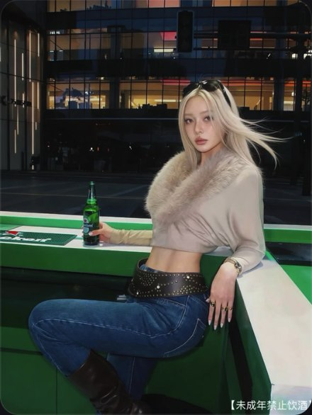

# R01 绿台面斜坐

图例定位为用户第 1 屏截图，原截图裁框 [460, 807, 1009, 1538]。完整原帖、设备和后期参数未知。以下先记录可见关系，再提出可迁移的拍法。

## 机位与构图

平视至略低的中远景，绿台面两条边在腰旁转折，弯腿展开到左下，暗楼占上方。

## 人物与造型

斜坐有承重点，一手落台边露出指甲，另一手持瓶；浅金发向一侧展开，脸转回镜头。

## 光线、颜色与表面

浅发和毛领在暗楼前清楚，绿瓶与台面呼应；牛仔哑面、毛领软边、金属腰带亮点有区分。

## 迁移拍法

迁移到深色木吧台，保留斜坐、弯腿和头发后暗背景，改用琥珀色杯子呼应台面。

## 失败对照

若改成站直、双手垂下并拍到大片楼面，曲线和台面转折消失。不要仅复制浅发毛领。

对照时同时看小图和大图，先核对前后距离、边界与明暗，再核对衣物细节。精确焦距、光圈、灯具和美颜参数不能从该截图确定。
