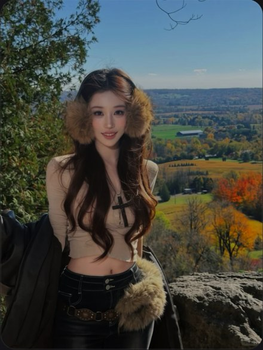

# R02 秋景毛耳罩

图例定位为用户第 1 屏截图，原截图裁框 [1685, 661, 2235, 1393]。完整原帖、设备和后期参数未知。以下先记录可见关系，再提出可迁移的拍法。

## 机位与构图

中景把耳罩、脸、腰部同时留住，风景分成树、人物、远山三层，地平线避开眼睛。

## 人物与造型

耳罩直接在脸旁形成体积；长发向下延伸到短衣腰线，腰边毛绒是第二个呼应。

## 光线、颜色与表面

脸和衣服比深发更亮，蓝天、秋树和棕毛绒各自成色块；并非所有颜色都压成棕调。

## 迁移拍法

换到城市公园，利用深色树影衬发，耳罩与包挂呼应，保留中景而非追求更大远山。

## 失败对照

若缩到脸很小，只剩风景与毛绒团，眼神和腰线都读不清。

对照时同时看小图和大图，先核对前后距离、边界与明暗，再核对衣物细节。精确焦距、光圈、灯具和美颜参数不能从该截图确定。
