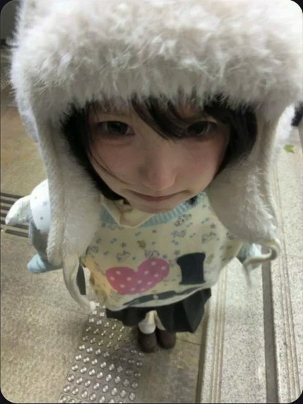

# R03 白帽高位俯拍

图例定位为用户第 1 屏截图，原截图裁框 [2298, 833, 2847, 1565]。完整原帖、设备和后期参数未知。以下先记录可见关系，再提出可迁移的拍法。

## 机位与构图

镜头高于头顶并靠近，毛帽近大、鞋远小，地面填满背景，近似俯视。

## 人物与造型

人物抬眼向上，黑刘海压住额头；帽沿围出眼睛，身体与鞋在后方收小。

## 光线、颜色与表面

白毛绒边缘有柔软细丝，黑刘海与眼睛集中在白色包围里；地砖粗糙度作区别。

## 迁移拍法

换针织大帽和旧书店地板，保留抬眼与头大身小；先检查真实机位可达。

## 失败对照

退远后裁近只能改变画幅，不能得到同样透视；帽沿压太低会遮眼。

对照时同时看小图和大图，先核对前后距离、边界与明暗，再核对衣物细节。精确焦距、光圈、灯具和美颜参数不能从该截图确定。
