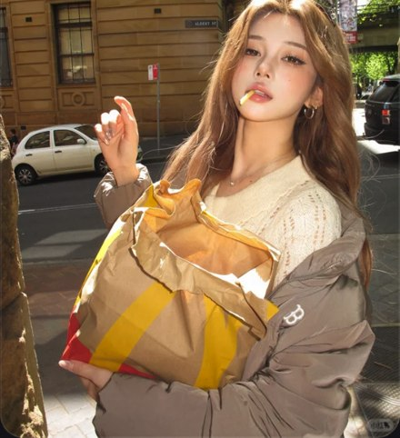

# R04 日光薯条街头

图例定位为用户第 1 屏截图，原截图裁框 [2911, 608, 3460, 1210]。完整原帖、设备和后期参数未知。以下先记录可见关系，再提出可迁移的拍法。

## 机位与构图

近至中景，下方大纸袋进入前景，人物偏一边，街道只承担位置与日光证据。

## 人物与造型

薯条停在唇边，手指半举，肩上外套滑下；看镜头给动作一个回应对象。

## 光线、颜色与表面

日光照亮头发边和纸袋褶皱，黄纸与暖发呼应；阴影仍保留深浅，皮肤亮点集中。

## 迁移拍法

换面包袋与花店门口，保留手到嘴的尺度和袋子前景；袋子不能压住下半张脸。

## 失败对照

只写拿食物会变成双手端袋的记录照；均匀柔光会减少发丝与纸褶的亮面。

对照时同时看小图和大图，先核对前后距离、边界与明暗，再核对衣物细节。精确焦距、光圈、灯具和美颜参数不能从该截图确定。
