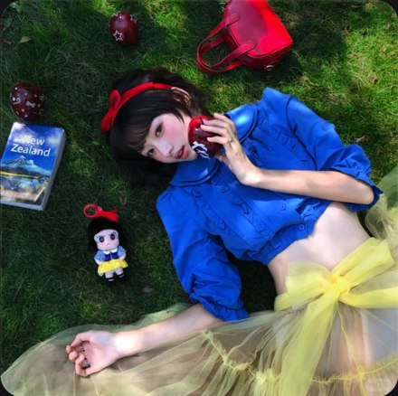

# R05 草地童话配色

图例定位为用户第 1 屏截图，原截图裁框 [2298, 1740, 2847, 2286]。完整原帖、设备和后期参数未知。以下先记录可见关系，再提出可迁移的拍法。

## 机位与构图

高处向下看躺姿，身体横斜，草地变成统一的深色底；物件分布在头侧和手边。

## 人物与造型

蓝上衣、黄纱裙与红头饰/苹果形成几处明确颜色，手肘和头部各有地面支撑。

## 光线、颜色与表面

深绿草把蓝黄红托出来；纱裙透明层、皮包亮面和草的细密表面不同。

## 迁移拍法

换野餐布和水果，保留横向躺姿、色块位置与支撑；用本次造型决定主色。

## 失败对照

逐个增加道具却不定位置会盖过脸；草地平视站拍不能继承这张的构图。

对照时同时看小图和大图，先核对前后距离、边界与明暗，再核对衣物细节。精确焦距、光圈、灯具和美颜参数不能从该截图确定。
