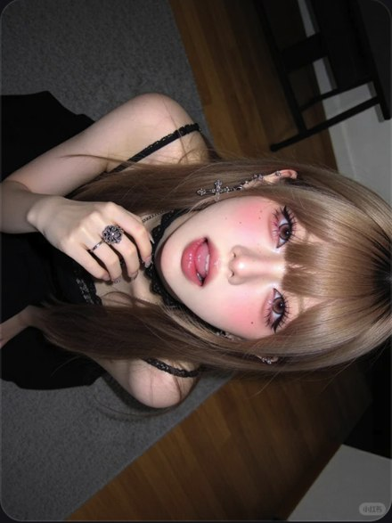

# R06 横置近脸

图例定位为用户第 2 屏截图，原截图裁框 [460, 834, 1009, 1566]。完整原帖、设备和后期参数未知。以下先记录可见关系，再提出可迁移的拍法。

## 机位与构图

画面横置，脸、发与手占满竖幅；旋转后的双眼和脸缘成为强斜线。

## 人物与造型

手与戒指贴近下巴，刘海给双眼留下窄而明确的窗口；嘴唇略分开。

## 光线、颜色与表面

脸部亮、背景暗，睫毛较清楚，颊色柔、唇和戒指有小高光；具体补光设备未知。

## 迁移拍法

换深棕发与银戒指，保留近距、斜向和局部锐度；按新脸型调整近镜距离。

## 失败对照

只做整张旋转而仍拍全身，脸仍很小；全图同等锐化会失去眼唇的层次。

对照时同时看小图和大图，先核对前后距离、边界与明暗，再核对衣物细节。精确焦距、光圈、灯具和美颜参数不能从该截图确定。
