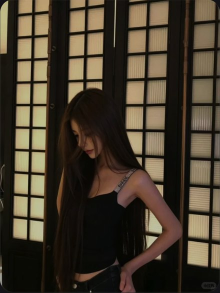

# R08 暖格窗低头

图例定位为用户第 2 屏截图，原截图裁框 [1685, 649, 2235, 1381]。完整原帖、设备和后期参数未知。以下先记录可见关系，再提出可迁移的拍法。

## 机位与构图

中景由亮窗格占后景，暗发与吊带在前；身体斜线和窗格竖线互相衬托。

## 人物与造型

低头、发帘落下、手压胯侧、弯肘离腰形成空隙；侧脸是观看重点。

## 光线、颜色与表面

暖窗亮、黑衣暗，颈侧/近脸留一小片亮，远脸可留暗；不把所有阴影均匀提亮。

## 迁移拍法

换暖色纸屏风和深灰上衣，保留亮背景、暗衣和低头；手可扶腰，不需另添阅读剧情。

## 失败对照

强行回头看镜头会丢掉侧脸发帘；全图提亮使窗格和暗衣失去层级。

对照时同时看小图和大图，先核对前后距离、边界与明暗，再核对衣物细节。精确焦距、光圈、灯具和美颜参数不能从该截图确定。
