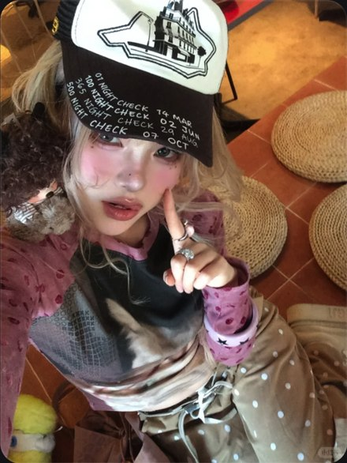

# R09 帽檐点脸

图例定位为用户第 2 屏截图，原截图裁框 [2298, 856, 2847, 1587]。完整原帖、设备和后期参数未知。以下先记录可见关系，再提出可迁移的拍法。

## 机位与构图

高位近拍，帽檐占上方、指尖从下方靠近脸，眼睛夹在两者之间，背景只剩小块。

## 人物与造型

点脸的手、戒指和粉色袖进入脸旁；帽子的图形比远处装饰更易读。

## 光线、颜色与表面

帽檐阴影压暗额头，脸上的粉色和唇亮点保留；衣服纹样密而脸部相对集中。

## 迁移拍法

换贴布渔夫帽与细条袖，保留帽檐/眼睛/指尖相邻关系。

## 失败对照

把帽子拍全而退远，眼神与美甲消失；手指遮住眼睛会破坏主次。

对照时同时看小图和大图，先核对前后距离、边界与明暗，再核对衣物细节。精确焦距、光圈、灯具和美颜参数不能从该截图确定。
