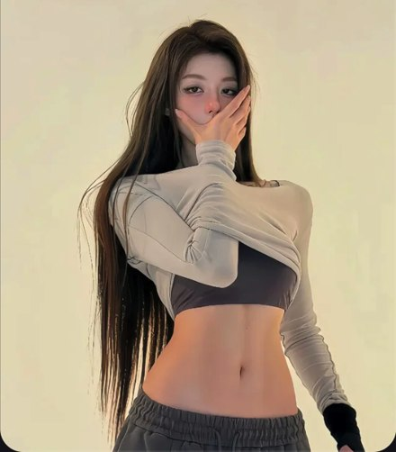

# R10 灰衣遮嘴

图例定位为用户第 2 屏截图，原截图裁框 [2911, 608, 3460, 1234]。完整原帖、设备和后期参数未知。以下先记录可见关系，再提出可迁移的拍法。

## 机位与构图

中近景、浅素背景，大面积腰部留在下半，长手臂与斜肩形成不同方向。

## 人物与造型

手遮嘴保留双眼，上衣层次和手臂斜线引到脸；胯略偏离肩。

## 光线、颜色与表面

灰黑贴身衣与裸露皮肤、浅墙形成三层亮度；伸展布料有细褶与哑光。

## 迁移拍法

换排练室素墙，保留遮嘴、露眼和衣服的斜向层次，按体型调整转角。

## 失败对照

全靠手遮脸会连眼神一起遮掉；高反差墙缝经过腰旁会抢走轮廓。

对照时同时看小图和大图，先核对前后距离、边界与明暗，再核对衣物细节。精确焦距、光圈、灯具和美颜参数不能从该截图确定。
