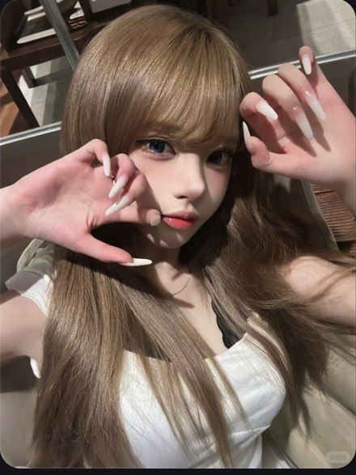

# R11 日光新发色

图例定位为用户第 3 屏截图，原截图裁框 [1073, 660, 1622, 1392]。完整原帖、设备和后期参数未知。以下先记录可见关系，再提出可迁移的拍法。

## 机位与构图

上身近景，发顶近上缘，双手一高一低围脸，白上衣只留必要面积。

## 人物与造型

长甲与刘海相邻，双手有空隙不挡双眼，头部微转让发面接光。

## 光线、颜色与表面

发顶一带日光照出浅发颜色，眼鼻有局部阴影，眼睫和唇可辨；亮发与白衣各有纹理。

## 迁移拍法

换深发新挑染，先找能照出挑染的一束光，再调整双手；分享重点随之改写。

## 失败对照

只换发色、仍用阴天全身，会失去颜色在日光下的光泽；不能只写韩系发色。

对照时同时看小图和大图，先核对前后距离、边界与明暗，再核对衣物细节。精确焦距、光圈、灯具和美颜参数不能从该截图确定。
