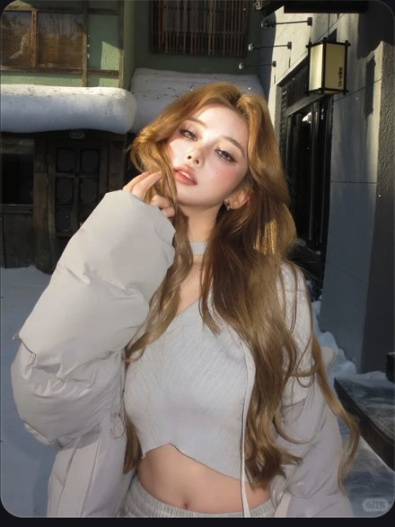

# R13 白羽绒卷发

图例定位为用户第 3 屏截图，原截图裁框 [2298, 981, 2847, 1713]。完整原帖、设备和后期参数未知。以下先记录可见关系，再提出可迁移的拍法。

## 机位与构图

中景让大羽绒袖围住小内搭，脸与卷发留在上半；暗街退后形成衬底。

## 人物与造型

手指停在颊边，肩略转，外套体积与露出的腰部形成比例。

## 光线、颜色与表面

一侧日光照亮发束和脸，白衣保留折面，背后比人物暗；卷发不是一整块金色。

## 迁移拍法

换深色店门前的短夹克，保留外大内小和受光卷发；按新衣料换高光表现。

## 失败对照

把白衣、脸、背景都提到同亮度会发平；只写卷发而没有受光方向不够。

对照时同时看小图和大图，先核对前后距离、边界与明暗，再核对衣物细节。精确焦距、光圈、灯具和美颜参数不能从该截图确定。
