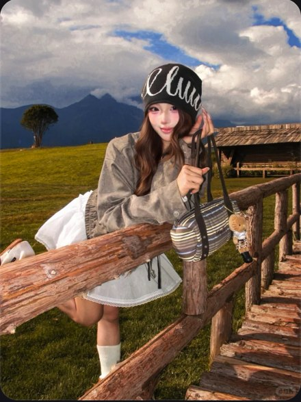

# R14 木栏旅行人像

图例定位为用户第 3 屏截图，原截图裁框 [460, 982, 1009, 1715]。完整原帖、设备和后期参数未知。以下先记录可见关系，再提出可迁移的拍法。

## 机位与构图

较宽的旅行人像与风景同框，木栏斜穿近处，人物靠栏，远山与天空在后方。

## 人物与造型

扶帽、靠栏、抬一腿形成姿态变化；包靠栏杆，部分腿被遮挡，承重脚和鞋尖在截图之外。

## 光线、颜色与表面

蓝天与绿草分区，白裙在灰衣下清楚，木栏纹理与柔软衣料有差别。

## 迁移拍法

换湖畔栏杆与城市远景，保留支点和腿部姿态，调整地平线避开脸。

## 失败对照

站到景点中央只剩小人；放大背景后再补锐化无法恢复原有身体占幅。

对照时同时看小图和大图，先核对前后距离、边界与明暗，再核对衣物细节。精确焦距、光圈、灯具和美颜参数不能从该截图确定。
