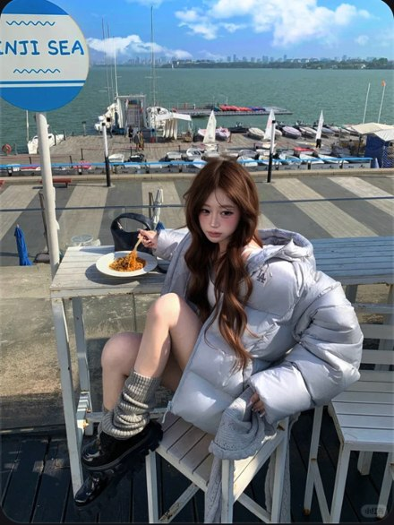

# R16 港口收腿坐姿

图例定位为用户第 4 屏截图，原截图裁框 [460, 931, 1009, 1662]。完整原帖、设备和后期参数未知。以下先记录可见关系，再提出可迁移的拍法。

## 机位与构图

较高机位拍收腿坐姿，桌椅构成近层，海港水平展开在后层，人物集中在下半。

## 人物与造型

羽绒服体积包住上身，一腿收在椅上，袜鞋与膝形成紧凑形状；手持叉靠近餐盘。

## 光线、颜色与表面

开阔日光，海面蓝、衣服浅、鞋深，衣服亮面与椅下阴影有区分。

## 迁移拍法

换露台餐桌与江面，保留椅上收腿的支撑和前景盘子，控制远景占幅。

## 失败对照

把所有海景都纳入会让脸太小；高机位要看椅面是否足以承重。

对照时同时看小图和大图，先核对前后距离、边界与明暗，再核对衣物细节。精确焦距、光圈、灯具和美颜参数不能从该截图确定。
