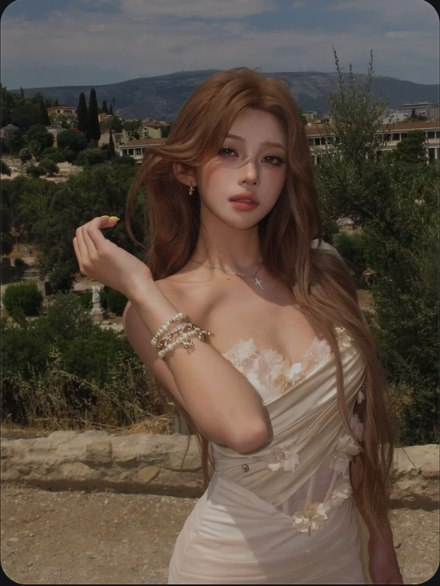

# R18 香槟裙旅行人像

图例定位为用户第 4 屏截图，原截图裁框 [1685, 746, 2235, 1478]。完整原帖、设备和后期参数未知。以下先记录可见关系，再提出可迁移的拍法。

## 机位与构图

中景让人物占纵向主体，远山较低，抬起的前臂在胸前构成斜线。

## 人物与造型

裙花、发束与手链都靠近脸肩范围；正面稳望也能形成主动拍照的状态。

## 光线、颜色与表面

香槟衣料略带亮面，手链有点光，远景绿灰较沉；光线设备与后期方式未知。

## 迁移拍法

换植物园露台和浅色礼服，按裙花位置决定手臂角度，保留较沉背景。

## 失败对照

强加边走边看风景会破坏手链与裙花关系；小花饰需足够大的中景。

对照时同时看小图和大图，先核对前后距离、边界与明暗，再核对衣物细节。精确焦距、光圈、灯具和美颜参数不能从该截图确定。
