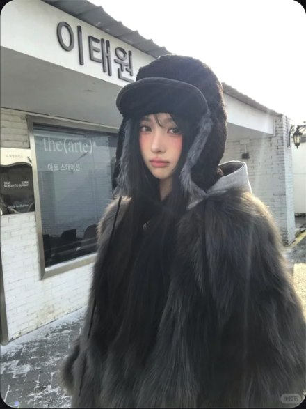

# R19 灰黑毛帽街头

图例定位为用户第 4 屏截图，原截图裁框 [2298, 955, 2847, 1687]。完整原帖、设备和后期参数未知。以下先记录可见关系，再提出可迁移的拍法。

## 机位与构图

头肩中近景，毛帽和深色外套占大块，浅店墙留下脸周围的外轮廓。

## 人物与造型

正面安静看镜头，帽沿与黑发围住眼颊，表情细微即可。

## 光线、颜色与表面

灰黑材料包住有血色的脸，毛发软边与白墙硬边对比；色彩收敛但肤色不灰。

## 迁移拍法

换深绒围巾和浅石墙，保留脸旁大体积与墙色反差。

## 失败对照

深发深衣放到同样深的墙前会混在一起；提亮全图可能使脸失去集中度。

对照时同时看小图和大图，先核对前后距离、边界与明暗，再核对衣物细节。精确焦距、光圈、灯具和美颜参数不能从该截图确定。
