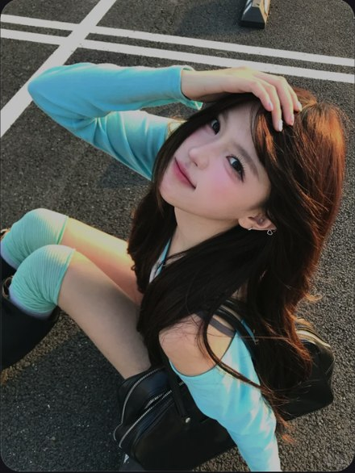

# R22 蓝袖高位俯拍

图例定位为用户第 5 屏截图，原截图裁框 [1685, 654, 2235, 1386]。完整原帖、设备和后期参数未知。以下先记录可见关系，再提出可迁移的拍法。

## 机位与构图

高机位近拍，地面填满背景，白线斜穿；脸近、膝远，手臂弧线绕过头顶。

## 人物与造型

坐低屈膝，近臂抬到发顶，头仰向镜头，一侧长发滑到肩前，支撑在地面。

## 光线、颜色与表面

青蓝袖对深灰柏油，暖色发光只占一侧；眼唇可辨，路面有颗粒。

## 迁移拍法

换书店低坐垫，保留头臂膝的前后关系，以地板缝替白线，深色书架只留边角。

## 失败对照

仅在平视照片里倾斜相机不会复制透视；膝太近或袖遮眼会抢过脸。

对照时同时看小图和大图，先核对前后距离、边界与明暗，再核对衣物细节。精确焦距、光圈、灯具和美颜参数不能从该截图确定。
