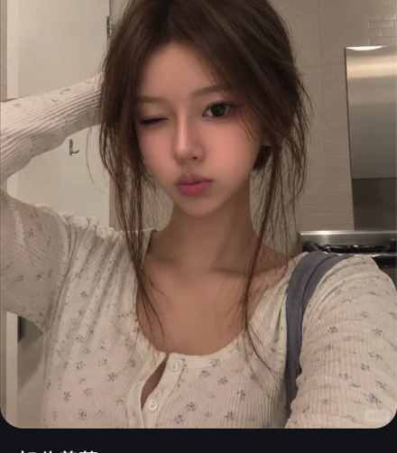

# R25 居家眨眼

图例定位为用户第 5 屏截图，原截图裁框 [2911, 608, 3460, 1234]。完整原帖、设备和后期参数未知。以下先记录可见关系，再提出可迁移的拍法。

## 机位与构图

前置近景或近距他拍的可见效果，相机略高，普通厨房在后，肘从画外进来。

## 人物与造型

松挽头发，一手在脑后，眨眼抿嘴；衣领只交代到上胸。

## 光线、颜色与表面

柔和室内亮度，肤色和唇清楚，散发细，背景结构低于脸部反差。

## 迁移拍法

换宿舍墙面与针织上衣，保留手后脑、松发和一只眼睛的变化；按实际选择自拍或他拍。

## 失败对照

不能从截图确定原设备，若选择自拍需补持机可达关系；全身会稀释小表情。

对照时同时看小图和大图，先核对前后距离、边界与明暗，再核对衣物细节。精确焦距、光圈、灯具和美颜参数不能从该截图确定。
