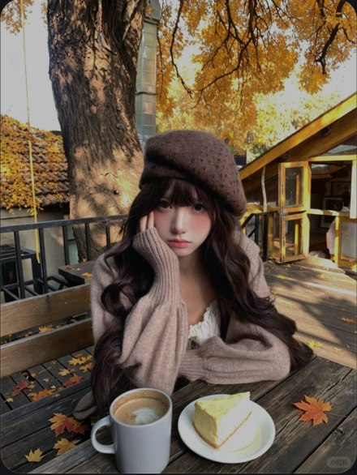

# R26 秋日隔桌咖啡

图例定位为用户第 6 屏截图，原截图裁框 [1685, 684, 2235, 1416]。完整原帖、设备和后期参数未知。以下先记录可见关系，再提出可迁移的拍法。

## 机位与构图

镜头在桌对面，杯和蛋糕贴下缘，手肘在中层，脸在帽沿和袖间，树与屋后退。

## 人物与造型

托腮看朋友，肘有桌面支撑；软帽与袖围住脸，另一臂在桌边松放。

## 光线、颜色与表面

黄叶可以比脸亮，但脸被深发和帽沿框住；杯口白、咖啡棕、木桌粗、袖软。

## 迁移拍法

换室内唱片试听桌，以封套作前景，保留隔桌距离、托腮与背景退后；秋色随现场变化。

## 失败对照

站着从几米外拍人坐桌边，桌面关系消失；不能把所有亮背景一概压黑。

对照时同时看小图和大图，先核对前后距离、边界与明暗，再核对衣物细节。精确焦距、光圈、灯具和美颜参数不能从该截图确定。
