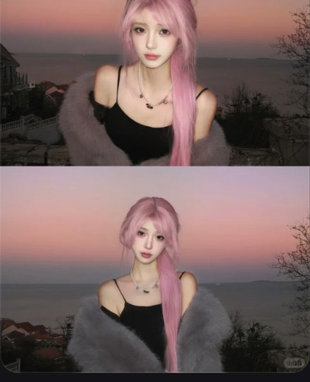

# R27 粉发日落双图

图例定位为用户第 6 屏截图，原截图裁框 [1073, 608, 1622, 1284]。完整原帖、设备和后期参数未知。以下先记录可见关系，再提出可迁移的拍法。

## 机位与构图

上下两幅相近半身，头肩姿态微变，同一海边日落和造型形成对照。

## 人物与造型

黑细带与灰毛披肩露出肩线，粉发是两张共有主角；小变化服务同一分享重点。

## 光线、颜色与表面

粉天与粉发邻近，深肩带作间隔，脸亮于背景，灰毛保留软边。

## 迁移拍法

换铜红发与暖暮色，保持相同光位和尺度；每张单独生成再按授权排成双图。

## 失败对照

只换地点重复同一姿势没有比较收益；本截图上幅发顶被页面截断，原图裁切未知。

对照时同时看小图和大图，先核对前后距离、边界与明暗，再核对衣物细节。精确焦距、光圈、灯具和美颜参数不能从该截图确定。
