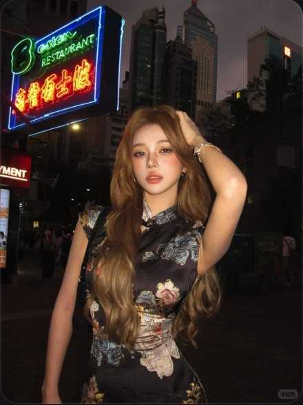

# R29 霓虹夜街

图例定位为用户第 6 屏截图，原截图裁框 [2911, 684, 3460, 1416]。完整原帖、设备和后期参数未知。以下先记录可见关系，再提出可迁移的拍法。

## 机位与构图

中景，人物在一侧，另一侧霓虹入画，手臂抬到发顶，暗街有纵深。

## 人物与造型

长卷发从肩上落下，手抬发根露出脸，正面稳望；衣纹与首饰保持局部可见。

## 光线、颜色与表面

脸明显亮于街，霓虹保留红绿蓝，发束与饰物有亮点；可借直闪实现但原照设备未知。

## 迁移拍法

换唱片店夜间招牌，主体离背景稍远，脸接正面补光，牌子放侧后；衣纹按新造型换。

## 失败对照

整街均匀提亮会失去夜色；只写夜景霓虹而脸曝光不定，容易变成黑脸。

对照时同时看小图和大图，先核对前后距离、边界与明暗，再核对衣物细节。精确焦距、光圈、灯具和美颜参数不能从该截图确定。
