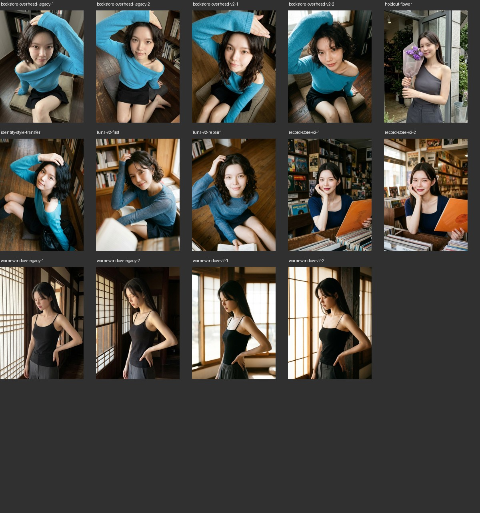

# V2 验证报告

日期为2026-11-14。源码 xhs-girl 2.0.0 联用 json-prompt-system 3.2.0。记录结构运行、调用模型与图像结果，人工审片者为本次执行 Agent 及独立审查 Agent，用户尚未评价这些新样片。

## 覆盖与产物

| 设计要求 | 已有证据 |
|---|---|
| 人物特点/分享意图推导拍法 | 主入口、迁移页、完整摄影卡，独立 A/B/C/D 应用卡 |
| 可视案例与迁移/失败对照 | 30张用户参考裁图、坐标哈希、30份案例、六张旧片逐张分析 |
| 镜头、构图、光线、质感 | 摄影方法页，各方法含条件与调整；9份可运行示例 |
| 身份与妆造/摄影分离 | 双参考完整示例与实际双参考生成，按上传顺序声明职责 |
| 新旧 JSON 兼容 | 9项回归测试，四旧模式正文逐字比较及纯JSON，四关系新卡、参数、缺字段、重复字段、图号与字面占位符 |
| 较弱调用模型易执行 | GPT-6-Luna low，5次无Skill对照、5次V2、修订说明后另5次，每次独立CLI调用 |
| 审片与针对返修 | 每张成功条件、人图两尺度检查，Luna样片按前景/俯角进行一次返修 |
| 迁移与原创 | 蓝袖摄影关系迁移书店；花店小束紫花为独立测试者留出任务，实际生图 |
| 保留原有能力 | 原有妆发、服装、人物表现、风格、组图、视频、判例与原帖观察均保留并接入新入口 |

## 结构与交接

`python3 -m unittest discover -s skills/image/json-prompt-system/tests -v` 最终9项通过。新入口测试先在旧CLI上失败，原因是不存在摄影参数；后新增重复字段与参考选项冲突测试，确实复现后修复。四旧模式逐字兼容，四种新关系可输出完整正文与纯JSON。九份包内例子实际编译通过。

`python3 skills/director/xhs-girl/scripts/check_package.py` 核对包内链接、30个案例资源与9个例子。它只检查资源闭包和可编译性，不评估审美。

独立应用测试者实际看总览和 R26/R21/R22/R08/R04，再完成 A唱片店、B书店俯拍、C暖窗低头、D花店四项。八次最终拼装退出0，卡片/纯JSON/正文内JSON一致。测试者在自审中修正了A初稿裁切与握持不能同框、B初稿机位数值不协调的问题，说明结构通过仍需语义复核。实际测试卡在 [application](application/A-record-store.card.json)。

## 较弱调用模型测试

请求模型 GPT-6-Luna，reasoning=low，Codex CLI 0.163.0，15次独立 ephemeral 调用均退出0并保存最终提示词。共同输入为 R22 实际裁图与“迁移到书店、换成年短卷发模特、约400汉字提示词”。无Skill对照5次，传入V2核心材料5次；发现边界问题后增补自检说明，再运行5次。原文和参数/输入哈希在 [luna/runs.json](luna/runs.json)。完整终端日志存于外部验证工作目录，含无关MCP启动警告，未把警告改报成工具运行成功。

人工逐条读完15份输出。无Skill对照已经五次写出高位俯拍与抬眼，不能据此宣称V2才首次获得该能力；它们更多采用奶油白裙、咖啡、阅读间隙与均匀柔光。V2首轮更明确写出头近膝远、四边界和近侧受光/远发留暗，但其中第2/3/5份的“大腿中段”下缘与膝部展示存在需要澄清的关系。补充“先定膝的位置再定下缘”的自检后，第二轮五份均改为膝下范围，仍有个别距离与物件描述可继续简化。没有将这些语言输出计作生成成功率，也没有推断所有较弱模型表现。

首轮V2第1份提示词未经挑选用于实际Flow生成，前景书页比预想大、俯角较参考平。按返修页只调整前景和相机高度再生成一次，原输出和返修输出均保留。

## 实际Flow图像比较

固定 Flow 项目、现有Chrome f10、Nano Banana 2.1，实际文件为896×1200，属本次指定1K原图。全部样本清单和源文件SHA-256在 [generated/manifest.json](generated/manifest.json)，包内图像为缩小教学副本，原始文件与任务回执在外部验证工作目录。本轮共14张，全部已收取并逐张审看，原片尺寸均为896×1200。

俯拍书店、暖窗暗调各用同一摄影设计分别走旧固定包装和新摄影入口，各生成两次，共8张。旧包装用旧模板字段承接同一设计，新包装使用摄影卡。人物参考、比例与工具相同，无法固定种子，JSON字段密度也不同，因此这是包装路径的观察比较，不是严格控制所有变量的实验。

| 样本 | 实际观察与局限 |
|---|---|
| bookstore-overhead-legacy-1/2 | 都有俯拍、蓝袖抬臂和抬眼。旧包装并未必然抵消明确设计；第二张较平，近膝与身体关系有所变化 |
| bookstore-overhead-v2-1/2 | 高位、手臂绕头与较近脸可见。第一张头发仍偏长，第二张短卷更接近设计；蓝衣有深浅变化 |
| warm-window-legacy-1/2 | 低头、黑衣、窗格与弯肘空隙均实现，脸部相对清楚 |
| warm-window-v2-1/2 | 低头保持，侧脸与颈更有侧向亮面，黑衣暗部保留；第一张窗格较松、明窗面积更大。现有样本不支持全面胜出 |
| record-store-v2-1/2 | 两次都在店内隔柜近拍，托腮、眼神、橙封套与前景唱片同时可读，比历史门外全身更接近本次设计；它们是新构思，不能当作只有包装改变的对照 |
| identity-style-transfer | 实际上传身份图与R22摄影图，保留蓝袖抬臂、抬眼与地板俯视关系，更换书店和模特；发长与原参考有差异，脸部相似度为人工观察 |
| holdout-flower | 从独立测试者留出卡生成，石墨斜肩衣、紫花脸旁、浅石柱与金属桶边可见，双眼看镜头；只有一张，未证明稳定原创成功率 |
| luna-v2-first | 能读到抬眼、蓝袖和书店，书页前景偏大，机位较平；保留为待修样本 |
| luna-v2-repair1 | 第二张机位明显更高，地板成为主要背景，书页缩到下缘一窄条，双眼和蓝袖更醒目；发型与身体姿态也有生成变化，属于文字调整后重生成，不能视为精确局部编辑 |

实际收图曾遇到提示末尾空白被Flow归一化、原请求历史不可读、重复提示UI结果归属、缩略图宽度过滤以及上传按钮中文文案变化。均保留原任务核对后恢复，未对已提交任务盲目重发。参考上传复用SHA-256/素材ID，新的R22裁图只上传一次。恢复使用现有CLI会话，没有重启浏览器或daemon，也没有将签名URL/凭据放入包。

## 独立审查与修复

独立审查实际查看30图总览、六旧片、七新片总览与三张新原图，运行9项测试、8份当时已有示例和四旧模式兼容检查。发现两项P2，均已修复：R14截图没有可见承重脚，已改为栏边旅行人像并区分完整全身原创方法；新增身份图+摄影图的完整可复制例子。未发现P0/P1。其余新文件随后按相同检查命令复核。

## 效果边界

本版的证据支持“摄影设计可完整交接、不同关系可生成、较弱调用模型能提供更具体输入、可以按可见问题返修”。这批小样不构成审美胜率、所有模型稳定性或用户最终满意度的证明。对身份、构图与整体吸引力继续按实际成片审看。
