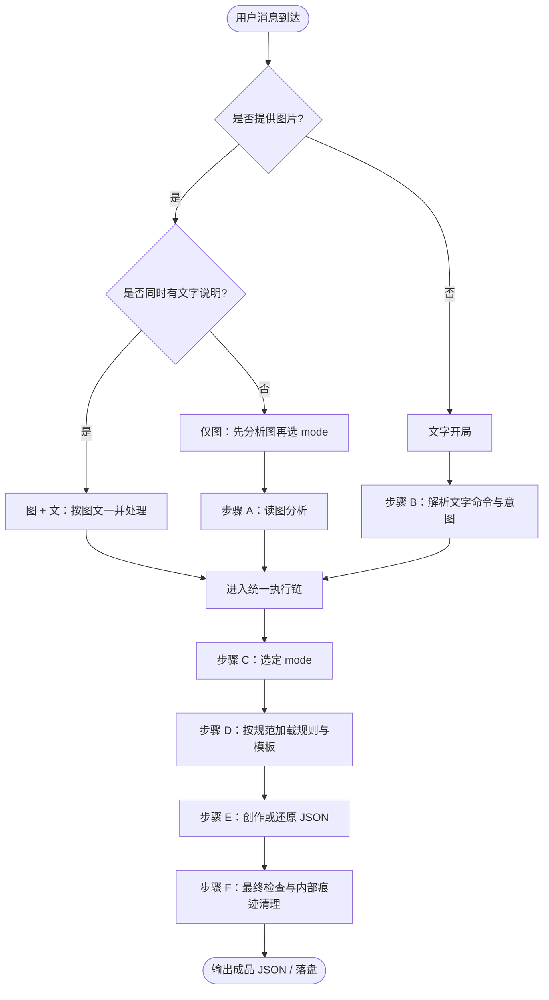
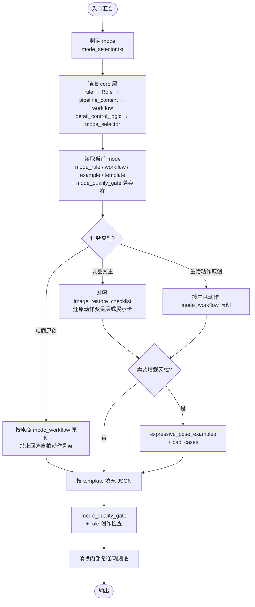

# 总流程图（启动与流程规范）

本文供 Agent **启动任务时**对齐入口分支与执行顺序；细则仍以 `core/workflow.txt`、`core/mode_selector.txt` 与各 `mode_workflow.txt` 为准。不得将本文件名或路径写入成品 JSON。

---

## 1. 入口总览（用户怎么进来）

---

## 2. 分支规范（必须遵守）

### 2.1 图 + 文

- **直接开工**：以用户文字为任务指令（动作母题、风格、是否还原、变体等），以图片为**主要依据**之一。
- 若文字与图片冲突，**先向用户澄清**；若用户明确「以图为准」或「以文为准」，按其优先级执行。
- 仍须完成 **mode 判定**（图往往已隐含 mirror / 前置 / 他拍 / 电商展示任务，须显式确认）。

### 2.2 仅图片（无文字或仅有无任务信息的附和）

- **禁止**跳过读图分析直接套模板。
- **必须先**完成 **步骤 A：读图分析**，至少明确：
  - 拍摄方式或展示任务（对镜 / 前置 / 第三视角 / 电商服装 / 电商上身）
  - 持机与手部逻辑（若可见）
  - 身体朝向、重心、关键姿势骨架
  - 表情与视线大致落点
- 再按 `core/mode_selector.txt` **选定 mode**，进入统一执行链。
- 若信息不足以致 mode 或动作不确定，**先简要列出假设或向用户提 1～2 个澄清问题**，再生成；不得凭空编造与用户图明显矛盾的结构。

### 2.3 仅文字（无图）

- **必须先**完成 **步骤 B：解析文字命令**：
  - 提取：任务类型（原创 / 还原某描述 / 改某字段）、动作母题、mode 线索、是否需要增强表达强度、落盘文件名意图等。
  - 若用户未给出 mode 线索，则根据关键词与 `core/mode_selector.txt` **自行推断 mode**；推断依据可内化，不写入成品 JSON。
- 再进入统一执行链。

---

## 3. 统一执行链（所有入口汇合后）

与 `core/workflow.txt`「一. 统一执行顺序」一致，此处用流程图压缩呈现：

---

## 4. 启动检查清单（Agent 自检）

在开始写 JSON 正文前，快速确认：

| 序号 | 检查项 |
|------|--------|
| 1 | 入口已归类：图+文 / 仅图 / 仅文 |
| 2 | 仅图时已完成读图分析，未跳过 mode 选择 |
| 3 | 仅文时已解析用户命令与任务类型 |
| 4 | mode 已选定且与 `mode_selector` 逻辑一致 |
| 5 | `pipeline_context` 已读：mirror 与固定场景参考对接时不写场景与灯 |
| 6 | 若是电商任务，已确认使用 ecommerce mode，且不走自拍动作骨架 |
| 7 | 成品将不含任何 `core/`、`flowchart.md`、规则文件名等内部痕迹 |

---

## 5. 与其它文档的关系

| 文档 | 作用 |
|------|------|
| `README.md` | 目录与阅读顺序说明 |
| `soul.md` | 系统气质与非谈判原则 |
| `flowchart.md`（本文） | **入口分支 + 统一流程**的规范总图 |
| `core/workflow.txt` | 逐步细节与最终检查项（权威步骤列表） |

---

## 6. 一句话

**有图就先从图里把「怎么拍、什么动作或展示任务」说清楚再选 mode；没图就把用户文字当命令书读透再选 mode；汇合后一律走同一套 core → mode → 模板 → 检查 → 无写入输出。**
